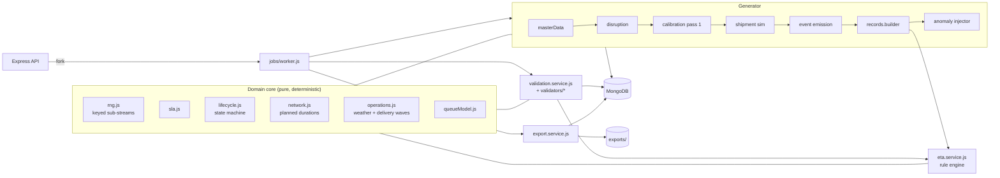
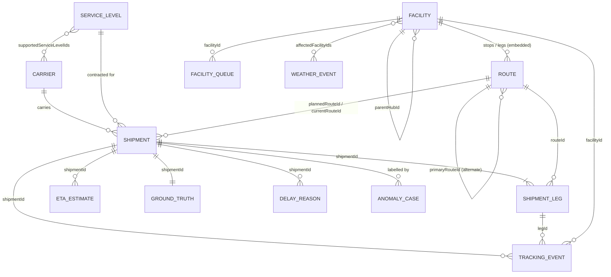

# Architecture & Design Decisions

## 1. Component view



* **One rule set, three consumers.** SLA deadlines, planned durations, the lifecycle state machine,
  the delivery-wave rule and the queue/weather model live in `src/domain/` and are imported by the
  simulator, the ETA engine *and* the validator. The validator therefore recomputes derived values
  with exactly the logic that produced them; any divergence is a real defect.
* **Long work never runs in the API process.** Generate / validate / export jobs are persisted in
  the `jobs` collection and executed by a forked worker (`src/jobs/worker.js`). A partial unique
  index on `jobs.activeLock` guarantees at most one active data job (bounded concurrency, HTTP 409
  otherwise). Workers heart-beat every 10 s; on server start, jobs silent for > 60 s are marked
  FAILED and their lock released.

## 2. Entity relationships



**Embedding vs. separate collections**

| Data | Decision | Reason |
|---|---|---|
| Route stops & route legs | embedded in `routes` | small, bounded, always read and versioned with the route (`routeId`+`version` unique) |
| Shipment `routeChange`, `lastMile` | embedded subdocuments | 1:1 with the shipment, written once |
| Shipment legs | separate `shipment_legs` | independently queried by facility/time, own lifecycle (PLANNED -> COMPLETED / CANCELLED) |
| Tracking events | separate `tracking_events` | highest volume (300k), append-only, indexed by `(shipmentId, sequence)`, `(shipmentId, occurredAt)`, `(facilityId, occurredAt)`, `ingestedAt` |
| ETA snapshots | separate `eta_estimates` | immutable history, one document per `(shipmentId, predictionAt)` (unique) |
| Ground truth | separate `ground_truth` | evaluation labels kept physically apart from prediction inputs |
| Delay reasons | separate `delay_reasons` | one per (shipment, reason) with exactly one primary |

**Referential integrity.** MongoDB has no foreign keys, so integrity is enforced in three layers:
(1) strict Mongoose schemas with business-ID format validation on every reference field;
(2) unique and compound unique indexes; (3) the validator's `REF_INTEGRITY` rule, which checks every
reference (including orphan detection for children whose parent does not exist) on every run.

## 3. Time semantics

| Time | Field(s) | Meaning |
|---|---|---|
| Event time | `tracking_events.occurredAt` | when the scan physically happened |
| Ingestion time | `tracking_events.ingestedAt`, `facility_queues.ingestedAt`, `weather_events.ingestedAt` | when the platform received the record |
| Prediction time | `eta_estimates.predictionAt` | information cut-off of an ETA snapshot |
| Delivery time | `shipments.deliveredAt` (observed), `ground_truth.actualDeliveredAt` (truth) | when the parcel was delivered |
| Snapshot time | `shipments.dataAsOf`, manifest `simulationWindow.asOf` | the dataset's "now"; nothing occurs or is ingested after it |

**Late-arriving event policy.** Events keep their true `occurredAt`; they become *usable* only from
their `ingestedAt`. An ETA at time *t* uses an event iff `ingestedAt <= t AND occurredAt <= t`.
Ingestion lag above 6 h is flagged (`TEMPORAL_LATE_INGESTION`, WARNING) but the event is retained.
`ingestedAt < occurredAt` is invalid (`TEMPORAL_INGESTED_BEFORE_OCCURRED`, ERROR). The baseline
contains realistic lags (scanner 1-10 min, driver app 1-15 min, EDI batches 15-120 min, delayed scans
1-5 h), all below the 6 h threshold.

## 4. Synthetic data generation

* **Determinism.** `rngFor(seed, namespace, key)` hashes `(seed, namespace, key)` with cyrb53 into a
  mulberry32 stream. Every record family draws from its own stream (`shipment/42`, `events/42`,
  `queue/FAC-007/bucket`...), so a record never depends on how many numbers other records consumed.
  No `Date.now()` or `Math.random()` is used for dataset content. Mongo `_id`s are excluded from
  checksums and exports.
* **Order.** master data -> disruption windows -> facility queue observations -> calibration
  (pass 1) -> shipments in batches (shipment -> legs -> events -> ETA snapshots -> ground truth ->
  delay reasons) -> anomaly partition -> manifest (counts, target check, checksums, edge-case
  catalogue).
* **Physical simulation, then observation.** `shipment.generator.js` produces the true timeline
  (pickup, every leg's dwell and transit with queue / weather / carrier components, reroutes, last
  mile, failed attempts, damage holds). `event.generator.js` turns scan opportunities into observed
  events with ingestion lag and missed scans, and drops anything not ingested by the snapshot time.
  Observed shipment fields (status, pickedUpAt, deliveredAt) are *derived from the observed events*.
* **Exact 300,000 events.** Pass 1 simulates every shipment and counts its natural events. The
  difference to the target is distributed one optional departure scan at a time, round-robin over a
  seeded permutation of shipments (`calibrateEventCounts`). The manifest records the natural count and
  the adjustment (e.g. tiny: 3,530 natural -> +70). This is documented calibration of an optional scan
  type, not padding.
* **Resumability.** The manifest stores a checkpoint after each committed batch. `--resume` deletes
  any partially written batch, recomputes the (cheap, deterministic) calibration and continues; the
  acceptance test interrupts a run mid-way and proves the resumed dataset has the same checksum as an
  uninterrupted one.

### Realism levers

| Lever | Implementation |
|---|---|
| Network | 14 hubs, 16 sort centers, 70 delivery stations in 50 US metros; stations feed their nearest hub; 4,830 primary + 4,496 alternate routes (9,326 total) |
| Demand | origin/destination weighted by city demand; business-hour tender profile |
| Service mix | Express 14%, Priority 24%, Standard 46%, Economy 16%; zone-based commitments |
| Carriers | 8 fictional carriers with transit factor, variability, scan compliance, EDI share, pickup reliability |
| Disruptions | regional weather climatology, severity 1-5, 70% forecasts issued 6-72 h ahead, 30% nowcasts |
| Queues | 4-hour buckets with type-specific peak hours, Monday surge, 5% congestion spikes, weather surge |
| Exceptions | 0.3% never picked up, 0.4% damaged holds, 3% failed first delivery attempt |
| Reroutes | at the origin hub when a known severe advisory covers the downstream hub (70%), or 1.2% capacity reroutes |

## 5. ETA engine (`eta-rules-v1.0.0`)

Transparent and rule-based; **not** a trained model.

```
ETA = predictionAt + base remaining duration + Σ facility adjustments + hold adjustment
```

1. **Eligibility.** Keep events with `ingestedAt <= t` and `occurredAt <= t`; drop exact duplicates
   (same type, facility, occurrence time).
2. **Position.** Replay eligible events along the planned route; an eligible `ROUTE_CHANGED` event
   switches to its target route. Backward or off-route scans are ignored (and lower confidence).
3. **Base remaining duration.** From the position, walk the remaining stops using planned dwell
   (`facility.baseProcessingMinutes x serviceLevel.handlingFactor`) and planned transit (ground or air
   per service level) x the carrier's configured `transitTimeFactor`. Without a departure scan the
   parcel is assumed to have left on its planned schedule (dead reckoning) - missing departure scans
   are common. Last mile follows the shared delivery-wave rule (08:00 wave, on-arrival dispatch until
   12:00, else next day) plus an expected 270 min on the van.
4. **Adjustments, without double counting.** For each remaining facility, `max(queue, weather)`:
   * queue = latest observation *ingested by t* (within 8 h) above baseline, only for facilities
     reached within 6 h;
   * weather = the strongest advisory *ingested by t* whose window covers the expected arrival;
   * each weather window is applied at most once per shipment. Queue observations already include
     weather surge, hence `max` rather than sum.
5. **Hold.** An open exception adds a 24 h hold. A failed attempt moves delivery to the next wave.
6. **Audit trail.** Each snapshot stores the watermark (events considered, last event, max ingestion
   time per source), the exact input IDs, the adjustment breakdown (which reconciles to the total),
   `configHash` and an `inputHash` over the eligible inputs. Evaluation (`actual - estimate`) is a
   separate sub-document added afterwards and is never read by the engine.

**Prediction schedule.** `createdAt + 1 h, 24 h, 48 h, 96 h` and the snapshot time, stopping once a
`DELIVERED` event has been *ingested*. Snapshots are immutable; new predictions are new documents.

**What the engine is allowed to see.** `toPredictionShipment()` passes only creation-time facts
(IDs, origin/destination, planned route, createdAt, plannedPickupAt, promisedDeliveryAt). Status,
deliveredAt, currentRouteId (a reroute is known only through an eligible event) and ground truth are
never inputs; a unit test proves mutating them does not change the estimate.

## 6. Ground truth and delay classification (`gt-rules-v1.0.0`)

Rules are evaluated in order (see `src/services/delay.service.js`):

| # | Condition | Label |
|---|---|---|
| R1 | delivered by asOf | `ON_TIME` if `deliveredAt <= promisedDeliveryAt`, else `DELAYED` |
| R2 | open DAMAGED exception | `OPERATIONAL_EXCEPTION` |
| R3 | no pickup scan > 24 h after tender | `INSUFFICIENT_DATA` (we do not invent an outcome) |
| R4 | asOf past the deadline | `DELAYED` (overdue) |
| R5 | no ETA available | `INSUFFICIENT_DATA` |
| R6 | ETA at asOf > deadline - service buffer | `AT_RISK` |
| R7 | otherwise | `ON_TRACK` |

`deliveryOutcome` (DELIVERED / NOT_DELIVERED) is reported alongside. Delay attribution
(`delay-attribution-v1.0.0`) sums recorded components: weather (leg + last-mile weather minutes),
facility congestion (queue minutes), carrier delay (positive carrier deviation + late pickup), route
change (extra planned minutes of the alternate path), delivery exception (failed-attempt minutes) and
missing tracking (overdue with no scan for 48 h). Reasons under 30 min are dropped; if none remain the
delay is `UNATTRIBUTED`. The largest contribution is primary (exactly one per delayed shipment).

## 7. Validation engine

Standalone (`npm run validate`), no Express required. Three passes:

1. **Schema pass** - one aggregation scan per collection computes required-field, enum and ID-format
   violations for every path derived from the Mongoose schema (including nested subdocuments), plus a
   business-ID uniqueness aggregation.
2. **Reference pass** - master data, routes, weather windows and every queue observation.
3. **Per-shipment merge-join** - six cursors sorted by `shipmentId` (shipments, events, legs, ETA
   snapshots, ground truth, delay reasons) are streamed together; children whose shipment does not
   exist are reported as orphans. Memory stays bounded by one shipment's records plus reference data.
   Every ETA snapshot is fully recomputed from the database.

Every failure produces `{ ruleId, severity, entityType, recordId, shipmentId, status, classification,
anomalyId, expected, actual, explanation, recommendedCorrection }`. A failure is `INTENTIONAL_ANOMALY`
only when the shipment carries a labelled anomaly case whose `expectedRuleIds` contains that rule;
everything else is `UNEXPECTED`. The run **PASSES** only if there are zero unexpected ERROR/CRITICAL
failures *and* every labelled anomaly was detected by all of its expected rules.

Rule catalogue: see `src/validators/rules.js` (39 rules) and the README table.

## 8. Anomaly design

Anomalies live in dedicated shipments (`SHP-2026-9xxxxx`, `partition: ANOMALY`). Each starts as a
clean simulated shipment and receives exactly one documented mutation, so baseline records are never
touched. `anomaly_cases` stores the scenario, variant, affected record IDs and expected rule IDs;
`anomaly_manifest.json` exports them together with the catalogue of *valid* edge cases (reroutes,
delayed scans, failed attempts, open exceptions, insufficient data, at-risk, weather delays) that the
validator must not flag.

## 9. Performance notes

* Bulk inserts in bounded batches (`BATCH_SIZE`, default 1000 shipments ≈ 6k events per write group),
  ordered writes, failures surface as `DataWriteError` (never swallowed).
* Indexes are created before loading; queries use projections and indexed sorts; exports and
  validation use cursors (`batchSize` 2000) with stream back-pressure.
* No unbounded `Promise.all` over records; the only parallel calls are fixed small sets.
* Measured at full volume (README section 14): 440 MB data / 95 MB compressed on disk / 63 MB indexes;
  generation 222 s, validation 63 s on a laptop with local MongoDB 8.0. Peak Node memory was not
  instrumented; the design keeps only reference data (routes, queue observations, weather) and one
  batch / one shipment's records in memory. Your hardware will differ.

## 10. Relational model: cardinality, bridge tables, effective dates, calendars

### Cardinality

"Required" means the child cannot exist without the parent (a NOT NULL foreign key in the SQL export).

| Relationship | Cardinality | Required? | MongoDB storage | SQL export |
|---|---|---|---|---|
| Facility → parent hub | N : 1 | optional (null for hubs) | `facilities.parentHubId` | FK `facilities.parent_hub_id` |
| Carrier ↔ Service level | N : M | — | array `carriers.supportedServiceLevelIds` | bridge `carrier_service_levels` |
| Route → origin / destination facility | N : 1 each | required | `routes.originFacilityId`, `destinationFacilityId` | FKs |
| Route → stops / legs | 1 : N (ordered) | required (≥ 2 stops, ≥ 1 leg) | embedded arrays `routes.stops`, `routes.legs` | child tables `route_stops`, `route_legs` |
| Alternate route → primary route | N : 1 (0..1 alternate per primary) | optional | `routes.primaryRouteId` | self-FK |
| Shipment → carrier, service level, origin, destination, planned route, current route | N : 1 each | required | scalar references | FKs |
| Shipment → shipment legs | 1 : N | required (≥ 1) | `shipment_legs.shipmentId` | FK |
| Shipment leg → route, from / to facility | N : 1 each | required | scalar references | FKs |
| Shipment → tracking events | 1 : N | optional (0 for never-picked-up tenders) | `tracking_events.shipmentId` | FK |
| Tracking event → leg, facility | N : 1 each | required | scalar references | FKs |
| Shipment → ETA snapshots | 1 : N | optional | `eta_estimates.shipmentId` | FK |
| ETA snapshot ↔ tracking events used / ignored | N : M (ordered) | — | arrays `inputs.eventIds`, `inputs.ignoredEventIds` | bridges `eta_input_events`, `eta_ignored_events` |
| ETA snapshot ↔ queue observations, weather events, remaining facilities | N : M | — | arrays in `inputs` | bridges `eta_queue_observations`, `eta_weather_events`, `eta_remaining_facilities` |
| Shipment → ground truth | 1 : 1 | required | `ground_truth.shipmentId` (unique) | FK |
| Ground truth → ETA at snapshot | N : 1 | optional | `ground_truth.etaAtAsOfId` | FK |
| Shipment → delay reasons | 1 : N | optional (≥ 1 exactly when DELAYED, one primary) | `delay_reasons.shipmentId` | FK |
| Delay reason ↔ evidence legs / facilities / weather events | N : M | — | arrays `evidence.*` | bridges `delay_evidence_legs`, `delay_evidence_facilities`, `delay_evidence_weather_events` |
| Weather event ↔ affected facilities | N : M | required (≥ 1) | array `weather_events.affectedFacilityIds` | bridge `weather_event_facilities` |
| Weather event → centre facility | N : 1 | required | `centerFacilityId` | FK |
| Facility queue observation → facility | N : 1 | required | `facility_queues.facilityId` | FK |
| Facility queue observation ↔ active weather events | N : M | — | array `activeWeatherEventIds` | bridge `facility_queue_weather_events` |
| Shipment leg ↔ weather events | N : M | — | array `shipment_legs.weatherEventIds` | bridge `shipment_leg_weather_events` |
| Shipment last mile ↔ weather events | N : M | — | array `lastMile.weatherEventIds` | bridge `shipment_last_mile_weather_events` |
| Anomaly case → shipment | N : 1 | required by ID (the ORPHAN case points at a deliberately missing shipment) | `anomaly_cases.shipmentId` | JSON manifest |

**Why arrays in MongoDB and bridge tables in SQL.** The many-to-many lists are small, bounded, written
once together with their parent and always read with it, so MongoDB embeds them (one read, no join,
atomic write). The relational export (`npm run export:sql`, `src/scripts/exportSqlJson.js`) normalises
every one of them into a bridge table with a composite primary key and two foreign keys, producing 27
tables in total. `--verify` loads the result into SQLite and runs `PRAGMA foreign_key_check`: baseline
data has 0 violations; every violation in `seed_anomalies.sql` belongs to a labelled invalid-reference
anomaly.

### Effective dates and lifecycle states

| Entity | Effective dates | Lifecycle |
|---|---|---|
| Carrier | static for the dataset | `active` flag |
| Service level | static | — (versioned through `serviceLevelId`) |
| Facility | static | `operatingStatus = ACTIVE` |
| Route | `version` + `effectiveFrom` (simulation start − 30 days); `(routeId, version)` unique | a changed route is a new version row; shipments keep the route they were planned on |
| Shipment | `createdAt` → `plannedPickupAt` → `pickedUpAt` → `deliveredAt`; SLA `promisedDeliveryAt`; `dataAsOf` snapshot | `CREATED → PICKED_UP → IN_TRANSIT → OUT_FOR_DELIVERY → DELIVERED`, with an `EXCEPTION` branch that can return to transit or delivery; `DELIVERED` is terminal |
| Shipment leg | `actualStartAt`, `actualDepartureAt`, `actualArrivalAt`; `cancelledAt` | `PLANNED → IN_PROGRESS → COMPLETED`, or `CANCELLED` when a reroute replaces it (history kept) |
| Tracking event | `occurredAt` (event time), `ingestedAt` (receipt time) | immutable, append-only |
| Weather event | `issuedAt` → `ingestedAt`; window `startAt` – `endAt` | `FORECAST` (issued before start) or `NOWCAST` (issued after start) |
| Facility queue | `observedAt` (start of a 240-minute window) → `ingestedAt` | immutable observation |
| ETA estimate | `predictionAt` (information cut-off) | immutable snapshot; `evaluation` added once the outcome is known |
| Ground truth / delay reason | computed at the dataset `asOf` | versioned by `labelRuleVersion` / `ruleVersion` |

### Calendars (carriers and facilities)

**Current behaviour.** SLA commitments count **calendar days in UTC**. The tender cut-off is a minute of
the UTC day, and last-mile delivery waves run every day at 08:00 UTC, including weekends. There are no
holidays, and no per-carrier or per-facility working calendars. Facility time zones are stored on each
facility (`timezone`) for information only.

**Why.** A single time base keeps generation deterministic and lets the validator recompute every
deadline and wave exactly. It also avoids inventing holiday data for fictional carriers, which would
add complexity without adding analytical value to a synthetic dataset.

**How calendars would plug in.** All calendar-sensitive logic lives in two shared functions, so adding
calendars is local:

1. Add a `calendars` collection: `calendarId`, IANA `timezone`, working weekdays, `holidays[]`, cut-off
   and delivery-wave times. Reference it from `carriers.calendarId` and `facilities.calendarId`
   (N : 1 each).
2. Change `serviceStartDay` / `computePromisedDeliveryAt` in `src/domain/sla.js` to advance by working
   days of the carrier calendar, and `plannedDeliveryWave` in `src/domain/operations.js` to skip the
   destination facility's non-working days.
3. The ETA engine and the validator's `SLA_DEADLINE_RECONCILIATION` rule already call these functions,
   and the simulator's SLA deadline does too; its last-mile step uses the same wave constants
   (`FIRST_WAVE_MINUTE`, `SECOND_WAVE_CUTOFF_MINUTE`) and would switch to the calendar-aware helper.
   Generation, prediction and validation therefore stay consistent.
